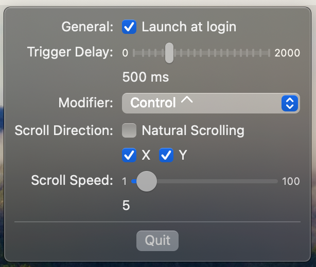

# huuuiii



huuuiii is a fork of [keyruu/Tabula](https://github.com/keyruu/Tabula), originally created by Lucas Rott.
It enables one-finger scrolling on macOS by converting pointer movement into scrolling while a modifier key is held.
The fork starts from Tabula 1.5.0 and retains its scrolling behavior while the changes in [FORK.md](FORK.md) are developed.

## Current features

- Hold a configurable modifier to scroll horizontally and vertically.
- Adjust scroll speed, activation delay, and scrolling direction.
- Enable launch at login.

The inherited settings interface is shown below.



Modifier combinations, modifier suppression, device filtering, updated permission guidance, and menu bar icon hiding are planned in [FORK.md](FORK.md).

## Build

Requires macOS 14.0 or later and Xcode with Swift 6 support.
The app uses Swift 6 language mode and pins LaunchAtLogin to version `1.1.0`.
Debug and Release share an unsandboxed configuration for global input observation and posting.

Open `huuuiii.xcodeproj` in Xcode and select the `huuuiii` scheme with the Debug configuration.
Debug uses “Sign to Run Locally”, so no development team or Apple account is required.

```sh
xcodebuild -project huuuiii.xcodeproj -scheme huuuiii -configuration Debug -destination 'platform=macOS' -derivedDataPath build -onlyUsePackageVersionsFromResolvedFile build
```

Local signing can require fresh permission grants after rebuilding; see [Apple's code-signing requirements](https://developer.apple.com/documentation/technotes/tn3127-inside-code-signing-requirements).
Release distribution requires your own signing team and certificate.
The app uses the bundle identifier `io.github.atamanroman.huuuiii` and keeps its preferences and login registration separate from Tabula.
Existing Tabula preferences are not migrated automatically, and macOS permissions must be granted to the fork separately.
Upstream releases and the `keyruu-tabula` Homebrew package install Tabula rather than huuuiii.

If Xcode reports a missing framework symbol in `IDESimulatorFoundation` before inspecting the project, install the system components matching the selected Xcode using [Apple's first-launch setup](https://developer.apple.com/documentation/xcode/downloading-and-installing-additional-xcode-components).

```sh
xcodebuild -runFirstLaunch
```

## Credits and license

Thanks to Lucas Rott for [Tabula](https://github.com/keyruu/Tabula), [arifiorino/Scroller](https://github.com/arifiorino/Scroller) for the base scrolling algorithm, and [othyn/macos-auto-clicker](https://github.com/othyn/macos-auto-clicker) for the permission-service reference.
The original author stated that Tabula is no longer maintained and explicitly invited forks.
Original author notices and inherited artwork are retained.

Changes made for huuuiii are licensed under the GNU General Public License, version 3 or, at your option, any later version (`GPL-3.0-or-later`).
See [LICENSE](LICENSE) for the full license text.
The inherited Tabula checkout did not contain a license file; adding this license does not establish permission to relicense inherited code or artwork.
Clarifying those upstream terms remains a release prerequisite in [FORK.md](FORK.md).
